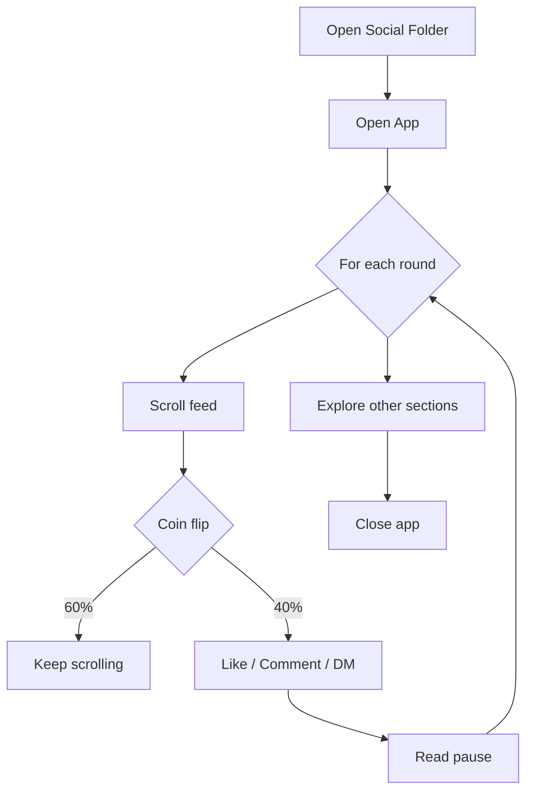

# Warmup

Social media account warmup scripts for the ESP32 iPhone agent. Builds natural
browsing history on Instagram, TikTok, X, LinkedIn, and YouTube so accounts look
like real humans, not bots.

## Philosophy

Platforms flag accounts that:
- Follow → like → comment on day one (no browsing history)
- Scroll at exactly the same speed every time
- Never pause to read/watch content
- Do the same action sequence identically every session

These scripts defeat all four signals:
1. **Gradual ramp** — each platform starts as open→scroll→leave, then slowly
   adds likes, comments, DMs, posts over sessions
2. **Human timing** — random pauses between every action; longer pauses after
   scrolling (simulates reading); hesitation before commit actions
3. **Pattern variation** — every session uses a different random action
   sequence; no two warmup rounds identical
4. **Coordinate jitter** — every tap has ±random pixel offset; scroll
   distances vary ±30%

## Scripts

| Script | Platform | Default warmup |
|--------|----------|----------------|
| `warmup-instagram` | Instagram | Feed scroll, like, comment, stories, explore, DMs |
| `warmup-tiktok` | TikTok | FYP scroll, like, comment, inbox, follow |
| `warmup-x` | X/Twitter | Timeline scroll, like, reply, retweet, DMs, notifs |
| `warmup-linkedin` | LinkedIn | Feed scroll, like, comment, connect, network |
| `warmup-youtube` | YouTube (Safari) | Shorts, search, watch, like, subscribe |
| `warmup` | Orchestrator | Run any/all platforms |

## Quick start

```bash
# Check the ESP32 is alive
curl http://127.0.0.1:8890/api/status

# Run all platforms once (3 rounds each)
./warmup

# Just Instagram, 5 rounds
./warmup-instagram --rounds 5

# TikTok and X, fast mode (less delay)
./warmup tiktok x --auto

# Run for 10 minutes, random platforms
./warmup --duration 10m

# See what it would do (no taps)
./warmup --dry-run
```

## Session structure

Each platform uses a **random session plan**. Every round picks 6-10 actions
randomly from: `scroll`, `like`, `read`, `comment`, `dm`. The mix changes
every run.



## Behaviour profile

Tune via environment variables:

| Env | Default | Effect |
|-----|---------|--------|
| `HUMAN_PAUSE_MIN` | 0.4 | Shortest pause between actions (sec) |
| `HUMAN_PAUSE_MAX` | 2.5 | Longest pause between actions (sec) |
| `HUMAN_READ_MIN` | 2 | Min "reading" pause (sec) |
| `HUMAN_READ_MAX` | 6 | Max "reading" pause (sec) |
| `HUMAN_COMMIT_HESITATE` | 0.8 | Pause before like/comment (sec) |
| `HUMAN_TAP_JITTER` | 6 | Random tap offset (±pixels) |
| `HUMAN_TYPING_CHAR_DELAY` | 0.03 | Per-character typing delay (sec) |
| `LIKE_PROBABILITY` | varies | Chance of liking each post (0-1) |
| `COMMENT_PROBABILITY` | varies | Chance of commenting (0-1) |

## Anti-detection details

**Scroll patterns:**
- Scroll distances vary randomly 70-130% of requested lines
- Mixed directions (mostly down, occasional up — like real browsing)
- Short flicks (1-3 lines) and longer scrolls (4-8 lines) interleaved
- Random pause after each scroll simulates reading

**Tap patterns:**
- Every tap has random pixel jitter (±HUMAN_TAP_JITTER) in x and y
- Hesitation before commit actions (like, comment, follow, send)
- Post-tap pause simulates reaction time

**Session patterns:**
- Random action order every round
- Variable platform weighting (Instagram more sessions than YouTube)
- Duration mode picks random platforms at random intervals

## Adding new platforms

1. Create `warmup-<platform>` in scripts/
2. Source `warmup-lib.sh`
3. Define `_open()`, `_scroll()`, `_like()`, `_leave()` functions
4. Add to PLATFORMS_ALL in `warmup`
5. Add icon position to `warmup-lib.sh`

## Account creation

Not yet supported. Each script assumes the target app is installed and signed
in. Account creation flow requires additional gate approval.